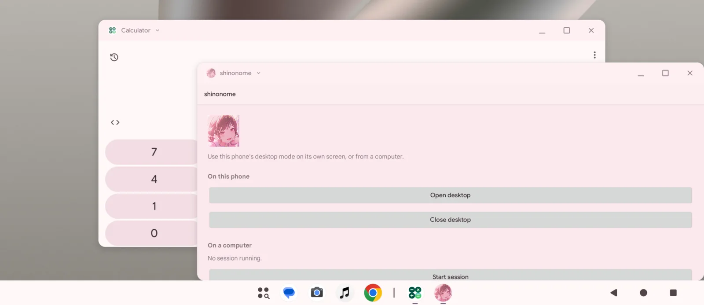

<p align="center">
  
</p>

<h1 align="center">Shinonome</h1>

<p align="center">Your Pixel's desktop mode, no monitor needed.</p>

<p align="center">
  <a href="https://github.com/wonderhoy-labs/shinonome/actions/workflows/ci.yml"></a>
  <a href="LICENSE"></a>
  <a href="#license-and-credits"></a>
</p>

Recent Pixels have a proper desktop mode built in, with a taskbar and resizable windows. The catch is that Android only
offers it when you plug in a monitor.

Shinonome gets around that by creating a virtual display that Android treats as a monitor. You can then use the desktop:

- on the phone's own screen, with no computer involved
- in a browser on your computer, with nothing to install, over Wi-Fi or a USB cable
- in [scrcpy](https://github.com/Genymobile/scrcpy) on Windows, macOS or Linux, over Wi-Fi or USB

It doesn't need root, and everything runs on the phone. When you use it from a computer you unlock the phone once, and
its screen stays off while you work.



> **This is early.** We've only tested it on one Pixel 10 Pro running Android 17, with a Mac as the computer. Nothing in
> the code is tied to that model and the app checks your phone before it starts, so other Pixels with desktop mode should
> work. If you try one, please [open an issue](https://github.com/wonderhoy-labs/shinonome/issues) and tell us how it
> went, even if it just worked.

## What you need

A phone whose Android build can put the desktop on a virtual display. Android 17 on the Pixel 10 Pro can. If yours gets
refused, turn on **Enable desktop experience features** in Developer options and reboot.

To use it in a browser over a USB cable, that's all. Turn on USB debugging and [the USB site](#in-a-browser-over-usb) does
the rest, and it can install the app for you if you want it. For everything else, you also need one of these to start it.
Neither needs root.

- [Shizuku](https://github.com/RikkaApps/Shizuku), which lets you do everything from the phone. The desktop on the phone
  needs it. Shizuku stops when the phone reboots, so you'll have to start it again in its app.
- `adb` on a computer, with USB debugging or Wireless debugging turned on in Developer options.

To use a browser, or scrcpy over Wi-Fi, the phone and computer have to be able to reach each other. That usually means
the same Wi-Fi. Guest networks and hotspots that isolate their clients won't work.

## Install

[The USB site](#in-a-browser-over-usb) can do this for you. Otherwise, download the APK from
[Releases](https://github.com/wonderhoy-labs/shinonome/releases) and open it on your phone, or install it with `adb`:

```bash
adb install -r shinonome-v0.2.0.apk
```

You can also [build it yourself](#development).

## Use it

### On the phone

Start Shizuku, open Shinonome and tap **Open desktop**. The first time, Shizuku asks you to allow it. The desktop then
fills the screen in landscape, and you can use it with touch, a mouse or the on-screen keyboard.

Swipe in from a screen edge to get to the system bars and leave. The desktop keeps running in the background until you
come back. If you open an app from outside, like from a notification, it gets moved into the desktop.

To shut it down, open Shinonome and tap **Close desktop**. Your windows go back to the phone.

### From a computer

#### In a browser over USB

This is the simplest way in, because the computer needs nothing but a browser.

1. Turn on **USB debugging** in Developer options, and plug the phone into your computer.
2. Open **<https://wonderhoy-labs.github.io/shinonome/>** in Chrome, Edge or another Chromium browser. Safari and Firefox
   don't have WebUSB.
3. Click **Connect phone** and pick your phone from the list. Unlock the phone, and tap **Allow** if it asks about USB
   debugging.
4. Choose what to do about the app. The site can install or update it and open it for you, you can install it yourself and
   the page carries on when it sees it, or you can skip it. The desktop in your browser doesn't need the app. It's for the
   desktop on the phone's own screen and for starting sessions from the phone. If you skip it, the site remembers and asks
   again when it has a newer version.
5. Click **Start it for me**. If the app's installed, you can pick **I'll start it on my phone** instead, which opens the app
   so you can tap **Start session** there. That one needs Shizuku.

Only one program can use USB debugging at a time, so if you have `adb` on this computer, stop it first. Close Android
Studio and any WebADB tabs too.

```bash
adb kill-server
```

If the cable comes out, plug it back in within two minutes and the page carries on by itself.

#### Everything else: start a session

A session is what creates the desktop for a computer to connect to. You can start one from either end.

**From the phone:** open Shinonome and tap **Start session**. This needs Shizuku. The app shows you the address, pairing
code and scrcpy commands.

**From a computer:** open Shinonome once so it can unpack its start script, then run this. It prints the same details,
and any [options](#options) go on the end of the line.

```bash
adb shell sh /sdcard/Android/data/com.wonderhoylabs.shinonome/files/start.sh
```

Then unlock the phone if it's locked. Android doesn't create the desktop until you do.

#### Connect

**In a browser,** open the `https://` address and type in the pairing code. Your browser will warn you about the
certificate, because the phone made its own. Go ahead and proceed. You only have to do this once.

**In scrcpy over Wi-Fi,** turn on Wireless debugging and connect `adb` using the details it shows. You only have to pair
once.

```bash
adb pair <phone-ip>:<pairing-port>
```

```bash
adb connect <phone-ip>:<port>
```

Then run the Wi-Fi command that the session printed. It looks like this, and the display ID changes each time:

```bash
scrcpy -e --display-id=12 --mouse=uhid --no-power-on --video-bit-rate=20M
```

**In scrcpy over USB,** turn on USB debugging, plug in the cable and approve the prompt on the phone. Then run the USB
command that the session printed:

```bash
scrcpy -d --display-id=12 --mouse=uhid --no-power-on --video-bit-rate=20M
```

Don't drop `--mouse=uhid`. Without it, dragging a window by its title bar crashes the phone's system UI and closes all
your windows. With it, scrcpy captures your mouse, and you press Left Alt or Left Super to get it back.

**In a browser through `adb`,** if you'd rather keep `adb` running than use the USB site, forward the port and open
`https://localhost:27183/`:

```bash
adb -d forward tcp:27183 tcp:27183
```

#### While a session is running

The phone's screen turns off when the first client connects.

You can still lock the phone with the power button. The session keeps going, but Android hides the desktop's taskbar and
status bar until you unlock it. If you leave the phone alone, it stays unlocked behind its dark screen and you keep the
taskbar. Press the power button again to see the lock screen and use your phone as normal.

If you lose the connection, you have two minutes to reconnect and carry on where you left off. After that the session
ends by itself. You can also end it yourself with **End session** in the web page or the app. Your windows go back to the
phone and return next time, and the phone locks if its screen was off or it was already locked.

Only one browser window can hold the session at a time. If you open a second one, it takes over and the first one tells
you so. The exception is the USB site, where a second window can't get at USB at all and says so instead. A browser and
scrcpy can both be connected at once, though.

The desktop takes the shape of your browser window, up to about 1920x1200, so there are no bars around the picture, in
fullscreen or out. In fullscreen, the toolbar goes away completely. Hold Esc to leave.

For the lowest latency, use a smaller desktop. Adding `--size 1280x720 --dpi 120` saves about 10 ms, and keeps the desktop
at that size.

## Use it in your app

The web side of Shinonome is a library, `@wonderhoy-labs/shinonome`, and both of its pages are built on it. It puts the
phone's desktop in any web page over `adb`: it starts the server from the APK it carries, then shows the desktop on a canvas
with the mouse, keyboard, sound, clipboard, dropped files and sharp mode. [Asahi](https://github.com/wonderhoy-labs/asahi)
uses it. Add a release by its address:

```json
"@wonderhoy-labs/shinonome": "https://github.com/wonderhoy-labs/shinonome/releases/download/v0.4.0/wonderhoy-labs-shinonome-0.4.0.tgz"
```

Bring an `Adb` from [Tango](https://github.com/yume-chan/ya-webadb), over WebUSB or the `adb` server:

```ts
import { DesktopSession, Phone, runDesktopLink } from "@wonderhoy-labs/shinonome";
import apkUrl from "@wonderhoy-labs/shinonome/shinonome.apk?url";

const phone = new Phone(adb, "My phone");
if (!(await phone.isServerRunning())) {
	const apk = new Uint8Array(await (await fetch(apkUrl)).arrayBuffer());
	await phone.startServer(apk, ["--screen-on"]);
}
const session = new DesktopSession(canvas, { onStatus: (status) => console.log(status) });
session.setSound(true);
await runDesktopLink(await phone.openDesktopSocket(), session);
```

| Export | What it does |
| --- | --- |
| `Phone` | Starts and finds the server, opens its socket, installs and opens the app, and saves files to Downloads |
| `DesktopSession` | Decodes and draws the desktop, sends input, plays sound, shares the clipboard, and switches sharp mode |
| `runDesktopLink` | Carries a session over the server's socket until it ends |
| `SessionMode`, `modeArgs`, `sameMode` | What a session shows: a desktop, the phone's own screen, or one app alone. `phone.serverMode()` says what a running server shows |
| `LaunchableApp` | An app on the phone's launcher, with its name and icon, from `phone.launchableApps(apk)`, to show alone |
| `MessageType`, `PROTOCOL` | The messages, for anything that talks to the server directly, described in [docs/protocol.md](docs/protocol.md) |

A session can also show the phone's own screen, or one app alone that fills the picture and follows the window's size.
Start the server with that mode's options, and restart it to change:

```ts
import { modeArgs, sameMode, type SessionMode } from "@wonderhoy-labs/shinonome";

const mode: SessionMode = { kind: "app", app: "airi://app/org.gnome.Calculator.desktop" };
const running = await phone.serverMode();
if (!running || !sameMode(running, mode)) {
	await phone.startServer(apk, ["--screen-on", ...modeArgs(mode)]);
}
```

An app is a link, which opens the way tapping it would, or an activity, such as
`com.google.android.calculator/com.android.calculator2.Calculator`. It opens when the first page connects, and again
for each new page if it was closed. The phone's screen and one app don't need Android's desktop windows, only Android 17.
`phone.desktopProblem(apk)` asks, before starting anything, whether the phone can make a desktop, and says why not.
One app alone can be taller than it's wide, so it fills a tall window too; a desktop never is.

To offer the phone's own apps, list them with their names and icons. It takes a few seconds and doesn't disturb a
running session:

```ts
const apps = await phone.launchableApps(apk); // sorted by name
const mode: SessionMode = { kind: "app", app: apps[0].component };
```

`onFirstFrame` fires for the first picture of each connection, so a page that switches what the server shows hears when
the new picture arrives.

It needs a browser with WebCodecs, a bundler that understands `?url` such as Vite, and a phone that allows USB debugging.
Everything exported has a comment saying what it does. The rest may change.

## What has been tested

| | On the phone | Browser | scrcpy |
| --- | --- | --- | --- |
| Where you see it | The phone's screen | A computer with a current browser | A window on Windows, macOS or Linux |
| Wi-Fi | Not needed | Yes | Yes, with `-e` |
| USB | Not needed | Yes, with the [USB site](#in-a-browser-over-usb) or `adb forward` | Yes, with `-d` |
| Install on the computer | No computer needed | Nothing | scrcpy and `adb` |
| Started with | Shizuku | The USB site by itself, or a session | A session |
| Dragging windows | Yes | Yes | Yes, with `--mouse=uhid` |
| Keyboard | On-screen. Physical not tried yet | Yes, US layout | Yes |
| Touch | Yes | Untested | Untested |
| Sound | Yes, from the phone | Yes on the USB site, in the browser or left on the phone. Untested on the Wi-Fi page | scrcpy's own, not checked by ear |
| Clipboard | Yes, the phone's | Yes on the USB site, text both ways. Untested on the Wi-Fi page | scrcpy's own, untested |
| Files | Not needed | Drop on the desktop for Downloads, USB site only | scrcpy's own, untested |
| Phone's density on the desktop | Not needed | Yes, with sharp mode on the USB site. Untested on the Wi-Fi page | Untested |
| Phone's screen | Shows the desktop | Off | Off |
| Tested with | Pixel 10 Pro | Chromium browsers on macOS | scrcpy 5.0.1 on macOS |

### Everything else that has been tested

- Sound, clipboard and dropped files, in Chrome on macOS through the USB site's code over the development `adb` server
  route, with the debug test window beeping: sound played with no underruns and 13 ms from capture to arrival, a
  `Cmd+V` reached the page as a paste, pasted text came back from the phone after a copy there, a dropped file landed in
  Downloads, and the sound button handed the sound back to the phone. The same server messages were checked over
  `adb forward`. Sound and clipboard on the Wi-Fi page share that code but haven't been tried there.
- Discord 352.17 on the desktop, in Chrome through the USB site's code: without sharp mode it came apart, whether moved
  there or started fresh. The page offered sharp mode 1.1 to 1.4 seconds after Discord came to the front, and **Turn
  on** made the desktop 3360x1844 at 420 dpi and restarted Discord, laid out properly, with its window where it was at
  1.75 times the size. With Chrome in front of it there was no offer, and the HD button still restarted Discord behind.
  A new browser window size in sharp mode left Discord running, and turning sharp mode off brought the offer back,
  which **Not now** put away. The Wi-Fi page's offer hasn't been tried.
- `--mirror` on the Pixel 10 Pro, with a bare client over `adb forward`: an 860x1920 picture of the phone's screen as it
  was, and a click on an app's back button went back on the phone. Turning the phone and the browser pages for it
  haven't been tried.
- `--app` on the same phone: Google's Calculator alone at 1920x1080, and GNOME Calculator from the Linux terminal through
  Airi's `airi://app/org.gnome.Calculator.desktop`, which Airi sized to fill the picture. The status said `appOpen`, and
  when the session ended the app closed instead of moving to the phone, which stayed awake and unlocked.
- 0.5.0's library through Asahi's development page: `launchableApps` listed 125 apps with icons on the Pixel 10 Pro in
  about 3.5 seconds and 23 on the emulator, and `desktopProblem` said yes on the Pixel and gave Android's reason on the
  emulator, which has no desktop windows. Settings and Google's Calculator alone on the Pixel, and Clock and Settings
  on the emulator, took clicks and keys, and followed the tab's size, including a portrait 1200x1460 for a tall tab.
  Switching the server between a desktop, the phone's screen and one app showed each new picture.
- Ending a session locks the phone, including after a client reconnects (`Dozing`, `isKeyguardShowing=true`).
- Windows return to the phone when a session ends, with no desks left over, and reappear in the same place next session.
- Real mouse drags through the page, with the phone's screen dark, moved the window exactly as far as asked, 3 for 3.
- Clicks, typing and right-click work through the page. Scrolling worked in an earlier run.
- A drag the browser cancels stops there, at `[60,45]` of `[180,135]`. Overlapping left and right presses are each sent once.
  The toolbar's empty parts pass clicks through to the desktop.
- A second browser window takes over once, and the first shows a notice and stays away.
- A browser and scrcpy work on one session together. Browser drags moved exactly while scrcpy recorded 364 frames over 22
  seconds.
- A browser connected and paired through `adb forward` over USB, and got a secure context with `VideoDecoder`. We didn't
  check video on that route.
- Starting a session closes the phone's desktop and its screen, leaving one display, from both `adb` and the app's button.
  **Open desktop** is refused during a session. **End session** and **Close desktop** work.
- Through the app's own screen, touch and mouse swipes moved a window exactly, and typing on the on-screen keyboard reached a
  text box. An app launched from outside was moved into the desktop.
- With Shizuku off, **Start session** shows the `adb` command for this phone, and running it starts a session.
- The on-screen keyboard stays away during computer sessions (`setDisplayImePolicy(id, HIDE)`).
- Chrome shows the certificate warning, and after proceeding the page is a secure context with `VideoDecoder`.
- `openssl s_client` negotiated TLS 1.3 by default and TLS 1.2 when asked.
- A fresh clone builds with no lint errors, and its APK ran end to end.
- The USB site, in Chrome on macOS over real WebUSB at 480 Mb/s, in plain `adb` mode and in Android's accessory mode: the
  browser's device list and the phone's Allow prompt, real mouse drags that moved exactly as far as asked, 3 for 3, typing into
  a text box, and every click landing. A fresh page rejoined the same session, including one started from the app. Pulling the
  real cable and plugging it back in reconnected by itself in the older accessory-mode run, and force-killing the browser and
  reconnecting worked first time. **End session** stopped the server and handed USB back.
- **Update it for me** took a real phone from 0.1.1 to 0.2.0 in place with the release key, in about 4 seconds, and opened the
  app.
- The desktop fills the window. In fullscreen on a 16:10 Mac it became 1912x1200 with no bars and no toolbar, and it went back
  when leaving. Drags still moved exactly on a resized desktop. scrcpy kept recording, with no errors, while a browser reshaped
  the desktop under it from 1920x926 to 1560x1200.
- The Wi-Fi page, generated from the TypeScript source and served by the updated app: pairing, drags 3 for 3, 10 of 10 clicks,
  57 frames per second and 29.6 ms capture to decoded.
- On an emulator, through the USB site's own code: **Install it for me** on a phone with no app, and on one with an older copy
  signed with another key, where Android refused and **Remove and reinstall** worked. **I'll install it myself** noticed a
  manual install by itself, **Skip for now** was remembered, and a refused device showed Android's reason.
- An ordinary app that tried the session's local socket got `Permission denied`, with `avc: denied { connectto }` from
  SELinux, so it never reached the server. That means the server's own check of the caller hasn't been exercised.

## How it works

Android decides whether a display gets the desktop by how the display was created, not by whether there's a real monitor
on the other end. Create a virtual display with the `TRUSTED` and `ALLOWS_CONTENT_MODE_SWITCH` flags, and Android treats
it like a monitor you just plugged in. The taskbar, status bar, title bars and window management are all Android's own.
Shinonome doesn't reimplement any of that. It only decides where the picture goes and passes your input back.

Normal apps aren't allowed to create a trusted display, but the shell user is. That's the user `adb` runs as, and it's
what Shizuku gives you, which is why none of this needs root. The APK contains both the app and a small server, and
`start.sh` launches the server with `app_process`, the same way scrcpy starts its own.

Two things about Android shape the rest:

- It won't create the desktop until the phone has been unlocked, so every session needs one unlock.
- A virtual display shares the phone's power state, so the desktop would go blank as soon as the phone slept. During a
  session, Shinonome wakes the phone back up whenever it sleeps and turns off only the physical panel. The phone is
  awake behind a dark screen, and can even be locked, while the desktop keeps running.

When the display goes away, Android moves its windows back to the phone. They come back to the same places next time,
because the display keeps the same unique ID.

From there, the picture takes one of three routes:

```
                         shinonome APK
                               │
          ┌────────────────────┴────────────────────┐
    Shizuku helper                            Session server
     (shell user)                              (shell user)
          │                                         │
 display "shinonome-app"                   display "shinonome"
          │                                ┌────────┴────────┐
   the app's surface                 H.264 encoder     scrcpy's server
          │                          ┌─────┴─────┐           │
   the phone's screen         TLS WebSocket  adb over  adb, Wi-Fi or USB
                                     │        WebUSB         │
                                  browser    browser   scrcpy window
```

### The desktop on the phone

There's no video stream or network here. The app is a full-screen surface, and it hands that surface to a helper running
as the shell user through Shizuku. The helper creates the display drawing straight onto it, so nothing gets encoded.

The desktop uses the phone's landscape resolution, at 4/7 of the phone's density so that desktop windows fit. Touch,
mouse and keyboard events go from the app to the helper, which injects them into the display. Volume, power and home stay
with the phone. Text fields bring up the phone's own on-screen keyboard over the app.

When you leave the app, the display switches to a tiny placeholder surface, and the apps on it keep running until you
come back.

### scrcpy

Both Wi-Fi and USB work, and it's stock scrcpy with no changes. The session only creates the display. scrcpy does the
rest with its own server, decoder and window, so Shinonome's video encoder isn't involved at all.

scrcpy pushes its own small server to the phone over `adb`. That server captures the display as H.264 and sends it back
through the `adb` connection, which is the only thing that differs between Wi-Fi and USB. Your input comes back the same
way. Within about two seconds, the session notices scrcpy's server and treats it as a client, so it turns off the phone's
screen and keeps the phone awake. When scrcpy closes, the session waits two minutes for another client.

`--mouse=uhid` makes scrcpy act like a physical mouse attached to the real display. scrcpy's default mouse sends events
to its own private mirror display instead, which is what causes [that crash](#scrcpys-default-mouse-crash).

With both connections up, scrcpy stops with an error unless you pick one, so the printed commands always do. If the phone
reports its Wireless debugging port, the Wi-Fi command uses `--tcpip=<ip>:<port>` instead of `-e` and connects by itself.

### The web app

The phone hosts everything: the page, the video and the connection. Nothing goes through an outside service.

The session server listens on port 27183 and serves the page from inside the APK. It has to be HTTPS, because browsers
only allow the video decoder on a secure page, so the phone generates its own certificate.

To pair, the server sends a random challenge and the browser answers with an HMAC-SHA256 made from the pairing code. The
code itself never crosses the network, and the browser remembers it for next time.

While a browser is connected, the phone's H.264 encoder reads the display with latency-first settings and no B-frames,
and the frames go out over a WebSocket on that same TLS connection. If your link can't keep up, the server drops old
frames and skips to a fresh key frame, so the picture never falls behind. The browser decodes with WebCodecs and draws to
a canvas.

Mouse, wheel and keyboard events go back over the same WebSocket. Keys are sent by position, which is why non-US layouts
currently type the wrong characters. On a Mac, Cmd acts as Ctrl, because that's what Android's shortcuts expect.

If the connection drops, the page reconnects every second, and the server lifts any held keys and buttons so nothing
stays stuck down.

Sound comes from Android's remote submix, the same source scrcpy uses, as 16-bit stereo PCM at 48 kHz in 10 ms
packets. Recording it moves the phone's sound to the browser, and the speaker button in the toolbar hands it back. Silence
isn't sent. The browser keeps 30 ms of sound queued, more if the link proves uneven, and drops a packet if it falls more
than 30 ms further behind, so the sound never drifts away from the picture. Browsers only play sound once you've clicked
or typed on the page, so until then it stays on the phone.

Paste with your computer's usual shortcut and the page sends its clipboard's text to the phone, then presses `Ctrl+V`
there. Copy on the phone and the text lands on your computer's clipboard. Only text is carried. Android shows
"Shell pasted from your clipboard" on the phone's own screen each time, because that's how the server reads it.

Over Wi-Fi, from capture to decoded and before your monitor, we measured about 35-42 ms at 1080p and about 26 ms at 720p.
A click takes about 90-100 ms to change the picture, and about 50 ms of that is Android itself.

### The USB site

The USB site is a Material 3 onboarding around the same video and input code as the Wi-Fi page. It's a static site that
runs entirely in your browser, so there's no server behind it, and any static host with HTTPS will do. It uses
[Tango](https://github.com/yume-chan/ya-webadb), the library behind WebADB, to speak `adb` over WebUSB.

When you click **Connect phone**, the page connects to `adbd` on the phone. The browser makes its own `adb` key, which is why
the phone asks you to allow it once. Then it reads the installed app's version and looks for a running server by reading its
log. If there's one it can talk to, it joins that session straight away, which is also how it carries on after a reload.

**Install it for me** hands the APK the site carries to Android's package installer over `adb`, then opens the app. An app
signed with another key can't be updated in place, so in that case the page offers to remove it first.

**Start it for me** pushes the server from the site to `/data/local/tmp/shinonome`, skipping that if the same copy is already
there, and runs the same `start.sh` as everything else with `--no-network`, so no port opens on your network. Then it opens
the server's local socket through `adb`.

From there it's the same messages as over Wi-Fi, each with its length in front instead of a WebSocket around it. There's no
TLS or pairing code, because `adb` has already authorized this computer and no network is involved.

The site always runs its own copy of the server, whether or not the app's installed, so the two always match. If a session
is already running with a server the site can't talk to, it replaces it.

Both web pages ask for the desktop to take the shape of their window, and the server resizes the display and restarts the
encoder to match. Android lays the desktop out again by itself, and a scrcpy window on the same session keeps going.

The site doesn't run scrcpy at all. scrcpy on the official WebADB site doesn't work on our test Pixel, and we haven't worked
out why. Using Shinonome's own server sidesteps that, along with [scrcpy's default mouse crash](#scrcpys-default-mouse-crash).

Drop files on the desktop and the site copies them into the phone's Downloads over `adb`, next to anything already there.

Sharp mode, the **HD** button, gives the desktop your phone's own density instead of 160 dpi, with 1.75 times the pixels
each way at the test Pixel's 420, so it keeps a desktop's worth of room. Text is sharper on a high-resolution screen, and
apps like Discord, which lay out at the phone's density whatever display they're on, draw properly. When one of those
comes to the front with sharp mode off, the page offers to turn it on, and turning it on restarts those apps, because
they only take up a new density from a fresh start. It costs latency: at 3360x1504, capture to decoded took 23.8 ms at the median and 49.6 ms at the 95th percentile, at 58
frames per second, against 13.7 and 30.1 ms without it. The Wi-Fi page has the same switch. Both remember it.

With a 1920x860 desktop and a window being dragged, capture to decoded took 13.7 ms at the median and 30.1 ms at the 95th
percentile in Chrome, at 63 frames per second with none dropped, and a click took about 58 ms to change the picture. That
was through the development `adb` server route. Over WebUSB itself, with Tango in Node, capture to arrival took 12.4 ms at
the median. Before the encoder change below, the same Chrome run took 23.4 ms, and a click 68 ms.

Three things got it there. The encoder is asked to run at its fastest rate, up to 480 frames a second, which finishes each
frame in about 9 ms instead of 18 even though the display only sends 60. Pointer moves go out at most every 4 ms, and
everything the page sends in one task crosses USB as one transfer, so a 1000 Hz mouse can't queue up input. And adb's
delayed acknowledgements are held to 128 KB, so the desktop can't be stuck behind a long run of other traffic.

## Security and privacy

Worth reading if you use this on a network you don't fully trust.

**While a session runs, anyone with the pairing code can use your apps without your PIN,** even with the phone locked.
That's the trade-off for only unlocking once. If you don't want that, `--pause-when-locked` stops input and video whenever
the phone is locked. The code stays the same between sessions. To get a new one, delete
`/data/local/tmp/shinonome/pairing-code` with `adb` and start a new session.

The web page uses TLS with a self-signed certificate, at TLS 1.3 when your browser supports it, and the server accepts
TLS 1.2 as well. Nothing can vouch for that certificate on a home network, so the first connection trusts whatever
answers. The session prints the certificate's SHA-256 fingerprint, which you can compare with the one in your browser.

The pairing code and TLS key live in `/data/local/tmp/shinonome`, readable only by the shell user. Any app you've given
Shizuku access can read them, and the server itself has adb-level control of the phone. Five wrong pairing codes in a row
lock out new attempts for 30 seconds.

**The USB site has the same access as `adb`,** because that's how it works. Code on that page can do anything `adb` can,
including installing apps, so only use the address above or a copy you host yourself. The key your phone trusts stays in that browser's profile. To take
that trust back, use **Revoke USB debugging authorizations** in Developer options. The session's local socket is only for
`adbd`. On our test phone, Android itself refuses ordinary apps that try to connect to it, and the server checks who's
calling as well.

## Options

These go on the end of the `start.sh` command.

| Option | Default | What it does |
| --- | --- | --- |
| `--mirror` | off | Show the phone's own screen instead of a desktop, at most 1920 pixels the long way. The phone's screen stays on, and the picture turns with the phone |
| `--app LINK` | off | Show one app alone instead of a desktop: a link such as `airi://app/foot.desktop`, or an activity such as `com.example/.Main`. It closes when the session ends |
| `--size WxH` | Fits the browser window | Desktop size. Setting this keeps it fixed, with bars if the window's another shape |
| `--dpi N` | `160` | Desktop density |
| `--bitrate N` | `20000000` | Video bitrate in bits per second, for the web app and the printed scrcpy commands |
| `--encoder NAME` | Android's choice | An encoder from `--list-encoders` |
| `--encoder-setting K=V` | none | Extra integer MediaCodec setting, repeatable |
| `--screen-on` | off | Leave the phone's screen on |
| `--pause-when-locked` | off | Stop the session while the phone is locked |
| `--grace N` | `120` | Seconds a session survives with no client |
| `--idle N` | `600` | Seconds to wait for the first client |
| `--port N` | `27183` | Web app port |
| `--no-network` | off | Don't open the web port, so only `adb` can reach the session. The USB site uses this |
| `--list-apps` | off | Print the launcher's apps, with names and base64 WebP icons, instead of starting a session |
| `--icon-size N` | `96` | The icons' size for `--list-apps` |
| `--check-desktop` | off | Print `desktop: ok`, or why this phone can't make a desktop, instead of starting a session |

## Troubleshooting

**"This phone did not make the display a desktop", or you just get an empty screen.** Your Android build doesn't extend
the desktop to virtual displays. Try turning on **Enable desktop experience features** in Developer options and rebooting.

**After a session, the phone is awake but its screen stays black.** The server turned the screen off and was stopped
before it could lock the phone. Press the power button twice and unlock. Since 0.5.1 the server locks the phone first
when a session ends, so this shouldn't happen again.

**"Shizuku isn't running".** It stops at every reboot, so start it again in its app. Or start the session from a computer
with `adb`, using the command the app shows you.

**Windows have no title bars and you can't drag them.** Another virtual desktop is running. End the session, tap **Close
desktop**, and start the session again.

**In scrcpy, all your windows closed and the taskbar restarted during a drag.** That's scrcpy's default mouse crashing the
system UI. Use the printed command, which has `--mouse=uhid`.

**scrcpy over USB says `Device disconnected` within seconds.** First check whether USB can carry data at all, without
scrcpy. This should print `16777216`:

```bash
adb -d exec-out "dd if=/dev/zero bs=65536 count=256 2>/dev/null" | wc -c
```

If it prints less, reboot the phone. On our test Pixel that fixed it, after new cables, other ports and different `adb`
settings had all made no difference. [Here's what we know.](#usb-that-stops-carrying-data) Wi-Fi with `-e` keeps working
in the meantime.

**`adb devices` shows the phone as `offline` over USB.** Over Wi-Fi, run `adb -s <wifi-serial> shell svc usb
resetUsbGadget`, or replug the cable.

**`adb devices` is empty with the cable plugged in.** Only one program can use USB debugging at a time, so close browser
tools like the USB site or WebADB.

**The USB site says something else is using USB debugging.** That's the same rule from the other side. Run `adb kill-server`,
and close Android Studio and any WebADB tabs. Android Studio and other tools can start `adb` again by themselves.

**Your phone isn't in the browser's list.** Check that USB debugging is on and that the cable carries data. Some are only for
charging. The list only shows devices with an `adb` connection, so it won't show a phone with USB debugging off.

**`more than one device/emulator`.** The phone is connected over both USB and Wi-Fi. Add `-s <serial>` from `adb devices`.

**scrcpy says `Multiple ADB devices` with `-e`.** `-e` means "the one network device", and a running Android emulator counts
as one too. Close the emulator, or swap `-e` for `-s <phone-ip>:<port>`.

**`adb connect` says `No route to host` on macOS, though `ping` works.** Restart adb's server with `adb kill-server`, then
connect again. `adb mdns services` can also go empty while `dns-sd -B _adb-tls-connect._tcp` still sees the phone.

**No address is printed, or the browser can't connect.** Check that both devices are on the same network. On networks that
only give the phone IPv6, the printed address is IPv6.

## Known issues

- Only one desktop can run at a time, so starting a session closes the one on the phone.
- The taskbar and status bar disappear while the phone is actually locked. Open windows keep working. A launcher in the
  web app is the likely fix.
- Touches on the dark screen may still reach the phone. We haven't tested this, and it matters in a pocket.
- Non-US keyboard layouts type the wrong characters in the web app.
- Discord, and other React Native apps, come apart on the desktop without sharp mode: a wide blank strip in the middle,
  text missing or clipped, and the chat cut off on the right. They lay out at the phone screen's density, 420 on the test
  Pixel, whatever display they're on, and the desktop's is 160. The server spots them by React Native's library in their
  APK, and the page offers sharp mode when one is in front. Turning it on restarts them, with their windows where they
  were, which closes anything open in them, a call included. Sharp mode costs some latency, so it stays off until you
  turn it on. In one run with Discord's window filling the desktop, a few of its labels still clipped in sharp mode.
- The clipboard can't be read while the phone is locked, and only text is carried.
- A physical keyboard on the phone's desktop hasn't been tried. Simulated keys arrived with the on-screen keyboard closed,
  but some got lost while it was open.
- The phone's desktop density is fixed at 4/7 of the phone's, with no setting yet.
- USB `adb` once stopped carrying data after about a day of uptime, until a reboot. We don't know why.
- The launcher crashed once in its own taskbar code (`TaskbarInteractor.setUserIsNotGoingHome`) and recovered by itself.
  We haven't seen it since, and don't know whether display changes here set it off.
- Still untested: other phones, Windows, Linux, Safari, Firefox, tablets, a real notification tap, and battery drain and
  heat over a long session.
- We don't know why scrcpy on the official WebADB site fails on our test Pixel. The USB site doesn't use it.

## Development

You need JDK 17 or newer and the Android SDK with platform 37. On Windows, use `gradlew.bat`.

Shinonome follows the [Wonderhoy Labs guideline](.claude/skills/wonderhoy-unification/SKILL.md), like every Wonderhoy Labs project.
The shared tools need Node 24 or newer and pnpm. Format before you commit, and check the result:

```bash
pnpm install && pnpm format && pnpm unify
```

```bash
cd android && ./gradlew :app:assembleRelease
```

The APK ends up at `android/app/build/outputs/apk/release/app-release.apk`. It's signed with your debug key unless you set
`SHINONOME_KEYSTORE`, `SHINONOME_KEYSTORE_PASSWORD`, `SHINONOME_KEY_ALIAS` and `SHINONOME_KEY_PASSWORD`.

| Where | What's in it |
| --- | --- |
| `android/app/src/main/java/com/wonderhoylabs/shinonome/server/` | The server and desktop: display, encoder, input, HTTPS and WebSocket, pairing |
| `android/app/src/main/kotlin/com/wonderhoylabs/shinonome/` | The app's screens and its Shizuku helper |
| `android/app/src/main/assets/web/` | The page the phone serves over Wi-Fi. Its `client.js` is generated from `web/`, so don't edit it by hand |
| `android/app/src/main/assets/start.sh` | Starts the server as the shell user, from `adb`, Shizuku or the USB site |
| `packages/shinonome/` | The library both web pages are built on: video, input, sound, clipboard, and starting the server over `adb` |
| `web/src/` | The USB site: TypeScript, Vite, React and [mdui](https://github.com/zdhxiong/mdui) for Material 3 |
| `android/app/src/debug/` | A test window that only debug builds contain |
| `tools/measure.ts` | Drives a real browser to measure latency, test real mouse drags, and check sound, clipboard and dropped files (`pnpm measure`) |
| `tools/theme.ts`, `tools/unify.ts` | The shared Wonderhoy Labs tools: the colours, and the guideline check |

To build the USB site, build the APK first, because the site carries it. You need Node 24 or newer and pnpm. `localhost` counts as a
secure page, so you can try the result without HTTPS.

```bash
pnpm install && cd web && pnpm test && pnpm build && pnpm preview
```

`pnpm dev` also lists whatever the `adb` server can see, so you can use an emulator or a phone without stopping `adb`, and
`pnpm measure` can do the same with `--dev-serial`. An emulator can test everything up to starting the desktop, which it
refuses because it has no desktop windows.

If you change `packages/shinonome/` or `web/src/phone-page/`, run `pnpm build:phone-page` in `web/` to regenerate the phone's
`client.js`, and commit the result. That way building the APK doesn't need Node. CI checks that the two match.

Pushing to `main` builds everything through [ci.yml](.github/workflows/ci.yml) and publishes the USB site to GitHub Pages,
whose source has to be GitHub Actions. Pushing a tag like `v0.1.0`, matching `VERSION`, builds everything and publishes a GitHub release through
[ci.yml](.github/workflows/ci.yml). It signs the APK with the repository's `SHINONOME_KEYSTORE_BASE64`, `SHINONOME_KEYSTORE_PASSWORD`,
`SHINONOME_KEY_ALIAS` and `SHINONOME_KEY_PASSWORD` secrets. Without them, each release gets a throwaway key and has to be installed
fresh instead of updating.

If you're reporting a bug, please include your phone model, Android build number and the start script's output, with the
**pairing code removed**.

<details>
<summary>Testing without breaking things</summary>

`pnpm measure` needs Node 24 or newer, Chrome, a debug build (`cd android && ./gradlew :app:assembleDebug`) and a running session.
It clicks and drags on a live phone, and it once clicked inside the real Settings app. It now targets the test window and
closes Settings first. Don't point it at real apps.

```bash
pnpm measure --serial <adb-serial> --host <phone-ip> --real-drag --clicks 0 --drag 0
```

- Never test drags with scrcpy's default mouse. It crashes SystemUI and closes every window on the desktop.
- An open browser tab can take the session away from the test, which quietly ruins a drag test. Use `--port` on both ends
  if a tab might be open. An old tab with page code from before the "replaced" message will keep doing this until you
  reload it.
- `input mouse swipe`, and drags sent straight to the server, skip the page's own handlers. Swipes can also hit the edge
  of an overlapping window. Check the target with the live `mBounds`, and use `--real-drag` to test the client.

A few tool quirks that cost us time:

- `input` wants the source first, as in `input touchscreen -d 0 swipe ...`. The other order fails, which is easy to miss
  in a script and looks like input going nowhere.
- `input keyevent` and `input tap` go to the focused display, and a new desktop takes focus. Use `-d 0` for the phone.
- `uiautomator dump` only reads the focused display.
- `aflags list` fails with "must be root", and `dumpsys settings` shows which package last wrote a setting but not when.
- macOS has no `timeout` command, and `javac` there is a stub unless a JDK is installed.

</details>

## Under the hood

Everything below was tested on a Pixel 10 Pro (`blazer`) on Android 17, SDK 37, build `CP3A.260905.009`, not rooted, with
a Mac on the same Wi-Fi. Source references are to AOSP `frameworks/base`, branch `android17-release`. You don't need any
of this to use Shinonome. It's here so nobody has to work it out twice.

<details>
<summary>The display flags, and why they qualify</summary>

The display is created as the shell user, with no `OWN_CONTENT_ONLY`, `AUTO_MIRROR` or `SHOULD_SHOW_SYSTEM_DECORATIONS`:

```
PUBLIC | TRUSTED | ALLOWS_CONTENT_MODE_SWITCH (1 << 17) | SUPPORTS_TOUCH | TOUCH_FEEDBACK_DISABLED
```

`OWN_DISPLAY_GROUP | ALWAYS_UNLOCKED` are added so the desktop stays usable while the phone is locked.
`DESTROY_CONTENT_ON_REMOVAL` has to stay off. With it, windows get left in hidden desks that pile up. Without it, Android's
`handleProjectedModeDisconnect` moves them back to the phone and removes the desk.

Here's why it qualifies, in order:

1. `DesktopStateImpl.isDesktopModeSupportedOnDisplay`: a non-internal display needs
   `ENABLE_DISPLAY_CONTENT_MODE_MANAGEMENT` and `WindowManager.isEligibleForDesktopMode(id)`.
2. `DisplayContent.isEligibleForDesktopMode`: needs system decorations, freeform support and `allowContentModeSwitch()`.
3. `DisplayManagerService` strips `ALLOWS_CONTENT_MODE_SWITCH` if `TRUSTED` or `PUBLIC` is missing, or if `AUTO_MIRROR`,
   `OWN_CONTENT_ONLY` or `SHOULD_SHOW_SYSTEM_DECORATIONS` is set.

Android only creates the desktop's desk after an unlock. `DesktopDisplayEventHandler` says "Do not create default desk if
keyguard is locked. It will be handled on unlock."

</details>

<details>
<summary>Keeping the desktop alive with the screen off</summary>

This took three attempts, and the reasoning is easy to lose.

A virtual display can't have its own power group. `LogicalDisplayMapper.assignDisplayGroupLocked`, with `separate_timeouts`
on as it is here, overrides `FLAG_OWN_DISPLAY_GROUP`. `DisplayGroupAllocator.isDesktopModeSupportedOnDisplayLocked` only
allows `TYPE_EXTERNAL` and `TYPE_OVERLAY`, so a `TYPE_VIRTUAL` display lands in the primary group with the phone. So when
the phone sleeps, the display goes `OFF`, gets a blank layer stack, and frames stop.

1. Turning it back on within 100 ms reported `ON` but produced 0 frames.
2. Waiting 400 ms first, with a watchdog that power-cycled the display when frames stopped, gave a black picture and only
   the odd frame.
3. What works is never letting the group stay asleep. On sleep, call `IPowerManager.wakeUp`, which leaves the phone `Awake`
   and locked, then force the panel off with `requestDisplayPower(0, OFF)`. Wait 250 ms before forcing it, because Android
   applies its own change a moment later on another thread, and a late change wins.

With that, we measured `mWakefulness=Awake`, `isKeyguardShowing=true`, panel `OFF` and desktop `ON`, with a real picture
and 27 to 30 changing frames per second during window drags.

The power button during a session:

| State when you press it | What happens | Tested |
| --- | --- | --- |
| Unlocked, screen dark | Locks, screen stays dark, desktop keeps running | Yes |
| Locked, screen dark | Lock screen shows, so you can use the phone | Yes |
| Lock screen showing, client connected | Screen goes dark, desktop keeps running | Once, with a real button press |
| No client connected, screen on | Normal sleep | Yes |

</details>

<details>
<summary>Why only one desktop can run at a time</summary>

With the phone's desktop and a session's display both alive, windows on the session's display had no title bars, window
buttons or rounded corners, so there was nothing to drag on any client.

A window gets its caption from `CaptionVisibilityHelper`, and `allowedForDisplay` refuses a non-internal display unless
`DisplayController.isDisplayInTopology` says it's in the topology. DisplayManager's topology had both displays, with the
phone desktop's as the root. But the Shell logged `onTopologyChanged: displayIds=[57]` and `relayout(task=...) null caption
controller, skipping`. We don't know why the Shell's copy lacked the second display.

Closing the other display without restarting the session didn't bring drags back on that display. With a new session and
one desktop, title bars returned and every real-mouse drag moved the window exactly as far as asked.

So `start.sh` ends the app's helper, which releases its display, and the app ends its own desktop before starting a
session. We didn't retest this after the stale display described below went away. Running one desktop avoids the question.

</details>

<details>
<summary><a name="scrcpys-default-mouse-crash"></a>scrcpy's default mouse crash</summary>

scrcpy's `Controller` sends mouse and touch events to `virtualDisplayId`, its own private mirror display. That breaks
window drags:

1. A title-bar drag reaches `DesktopTasksController.getOrCreateVisualIndicator` with the event's display ID.
2. `displayController.getDisplayContext(displayId)` returns null, because SystemUI can't see a private display.
3. `DesktopStateImpl.<init>` throws a `NullPointerException` on `wmshell.main`, and SystemUI restarts, which closes the
   desktop's windows.

We saw this once, using scrcpy's exact control messages, and didn't repeat it on purpose.

`--mouse=uhid` creates an input device tied to the real display by its unique ID, and Android reported `Pointer Display ID`
as the session's display. Drags through scrcpy's server, sent as its mouse reports, moved the window with the pointer over
both Wi-Fi and USB, like `[140,93]` for `[141,94]`, with no crash. Text and a special key sent as its keyboard messages
reached a focused text box correctly.

The printed commands also ran cleanly in a real scrcpy window: 46 seconds over Wi-Fi with USB also connected, and 61 seconds
over USB with a window being dragged (3,730 frames at 9.4 Mbit/s). scrcpy with `-e` was also used by hand. Recordings have
an Opus audio track, but nobody has checked the sound by ear.

</details>

<details>
<summary><a name="usb-that-stops-carrying-data"></a>USB that stops carrying data</summary>

scrcpy over USB works after a phone reboot. We don't know what caused the failure before that, and it may come back.

Before the reboot, after 29 hours of uptime, `adb` couldn't reliably read from the phone over USB, with no scrcpy or server
involved:

| Direction | Result before the reboot |
| --- | --- |
| Phone to Mac, 17 MB or more | Dropped after 0 to 3.7 MB |
| Phone to Mac, paced at 4 KB/s | Dropped after 3 to 8 seconds |
| Mac to phone, 200 MB | Held, at 216 to 302 Mbit/s |

Each drop went the same way:

1. The Mac logged `usb_read failed with status: e00002ed`, or `e00002e8` right after a reconnect.
2. The phone logged `adbd: UsbFfs: connection terminated: write N failed with error Broken pipe`.
3. About 28 ms later it logged `Usb state update DISCONNECTED`, and was back within a second. `adbd` didn't restart.

These made no difference, so they weren't the cause: a second cable, a second USB controller on the Mac, `adb`'s libusb
backend (`ADB_LIBUSB=1`), quitting a Chromium-based browser that had the device open, and disconnecting Wi-Fi `adb`.
`svc usb resetUsbGadget` recovers a connection stuck at `offline`, but it didn't stop the drops.

After the reboot, `adb exec-out dd` delivered 197 MB three times in a row at about 100 Mbit/s, and paced transfers held.

We don't know what put the phone in that state, or whether Shinonome contributed. `adb`'s log shows read errors from about
four hours after that boot. A new session, a dark screen and scrcpy didn't bring it back. We haven't rechecked USB after
locking during a session or after long uptime. If it comes back, please note what ran beforehand, since that's the evidence
we're missing.

</details>

<details>
<summary>Latency numbers</summary>

Over Wi-Fi with the phone's screen on, dragging a window. All in milliseconds, before the monitor.

| Setting | Capture to decoded, p50 / p95 | Encode | Wi-Fi | Click to change, p50 |
| --- | --- | --- | --- | --- |
| 1080p, defaults | 42.5 / 52.6 | 25.2 | 9.0 | 99 |
| `low-latency=1` | 39.6 / 52.2 | 25.7 | 7.9 | 96 |
| `operating-rate=32767` | 41.1 / 51.5 | 25.3 | 8.1 | 89 |
| Operating rate 480, 1920x860, over USB (later) | 13.7 / 30.1 | 9.0 | 1.8 | 58 |
| `bitrate-mode=2` (CBR) | 39.8 / 49.6 | 25.0 | 7.3 | 94 |
| `profile=1` (baseline) | 38.8 / 51.4 | 25.7 | 7.3 | 89 |
| Software encoder | 276 / 326 | 270 | 3.6 | 289 |
| 1280x720 | 25.7 / 35.4 | 16.5 | 4.6 | 88 |

- The differences between the 1080p rows are within run-to-run noise. Encoding sets the floor at about 25 ms.
- `operating-rate=32767` did nothing because the Pixel's encoder ignores any operating rate above 480, at every size.
  At 480 or below it takes it: capture to encoded went from 21.5 to 9.5 ms at 1920x1080 (300 gave 10.9, 180 gave 13.1),
  and from 18 to 9 ms at 1920x860, where it says it could go to 600. The bit rate didn't change. The server now asks for
  the encoder's fastest rate for the size, up to 480.
- `1920x1080` at 120 Hz and `1600x900` at 120 Hz gave no real gain, and frames stayed capped near 60 per second, so we
  removed that option.
- Browser decoding takes about 1.3 ms, and sending takes under 1 ms.
- Click to change includes Android's own input and drawing stages, at about 50 ms.
- With the phone truly locked and its screen dark, clicks went 16 for 16 at about 75 ms.
- We haven't measured latency for scrcpy or the desktop on the phone.

</details>

<details>
<summary>Things we learned the hard way about the phone's desktop</summary>

- An app opened from outside the desktop lands on display 0, over the app, with no title bar. When the app pauses, the
  helper checks the focused task and, if it's an ordinary app on display 0, moves it with `startActivityFromRecents` and a
  launch display. Home, recents and Shinonome's own screen are left alone. Android remembers which windows belonged to a
  desktop, so a window moved in by mistake comes back the next time it opens.
- Without `ALWAYS_UNLOCKED`, locking made Android tear the desktop down: windows moved to the back, title bars were
  disposed and a new secondary home started.
- The lock screen forces portrait, so the app ignores portrait surface sizes instead of resizing the desktop.
- Shizuku reaches a new process a moment after it starts, so a quick tap could wrongly report that it wasn't running. The
  app now waits briefly.
- Two live displays must never share a unique ID. Removing one made `DisplayTopologyXmlStore` throw "Can't map uniqueId",
  because the ID-to-display map holds one entry per ID. The app and sessions use different IDs now. That crash also left a
  stale display in WindowManager and the Shell for hours. It went away without a reboot, and we don't know what cleared it.

</details>

## License and credits

Shinonome is a [Wonderhoy Labs](https://github.com/wonderhoy-labs) project, released under the
[Apache License 2.0](LICENSE). It isn't affiliated with Google.

It stands on the work of these projects:

- [scrcpy](https://github.com/Genymobile/scrcpy). The process setup in
  `android/app/src/main/java/com/wonderhoylabs/shinonome/server/Hidden.java` is adapted from its `Workarounds` and `FakeContext`
  classes, under the Apache License 2.0. Copyright (C) 2018 Genymobile, Copyright (C) 2018-2026 Romain Vimont.
- [Shizuku](https://github.com/RikkaApps/Shizuku). The app includes the
  [Shizuku API](https://github.com/RikkaApps/Shizuku-API) libraries under the MIT License.
- [Tango](https://github.com/yume-chan/ya-webadb), by Simon Chan. The USB site bundles its libraries under the MIT License.
  The site publishes the notices for everything it bundles as `third-party-licenses.txt`, including
  [React](https://react.dev/) and [mdui](https://github.com/zdhxiong/mdui).
- [Jetpack Compose and AndroidX](https://developer.android.com/jetpack) (Apache 2.0), for the app's screen, and
  [Material Color Utilities](https://github.com/material-foundation/material-color-utilities) (Apache 2.0), which makes the app's and
  the site's colours from Shinonome Ena's image colour.

<details>
<summary>Shizuku API license</summary>

```
MIT License

Copyright (c) 2021 RikkaW

Permission is hereby granted, free of charge, to any person obtaining a copy
of this software and associated documentation files (the "Software"), to deal
in the Software without restriction, including without limitation the rights
to use, copy, modify, merge, publish, distribute, sublicense, and/or sell
copies of the Software, and to permit persons to whom the Software is
furnished to do so, subject to the following conditions:

The above copyright notice and this permission notice shall be included in all
copies or substantial portions of the Software.

THE SOFTWARE IS PROVIDED "AS IS", WITHOUT WARRANTY OF ANY KIND, EXPRESS OR
IMPLIED, INCLUDING BUT NOT LIMITED TO THE WARRANTIES OF MERCHANTABILITY,
FITNESS FOR A PARTICULAR PURPOSE AND NONINFRINGEMENT. IN NO EVENT SHALL THE
AUTHORS OR COPYRIGHT HOLDERS BE LIABLE FOR ANY CLAIM, DAMAGES OR OTHER
LIABILITY, WHETHER IN AN ACTION OF CONTRACT, TORT OR OTHERWISE, ARISING FROM,
OUT OF OR IN CONNECTION WITH THE SOFTWARE OR THE USE OR OTHER DEALINGS IN THE
SOFTWARE.
```

</details>

Shinonome is named for Shinonome Ena of 25-ji, Nightcord de., from Project SEKAI COLORFUL STAGE! feat. Hatsune Miku. Wonderhoy Labs is a
fan project, not affiliated with SEGA, Colorful Palette or Crypton Future Media, who own Project SEKAI and its characters.
The Apache License doesn't cover the Shinonome name or logo.
